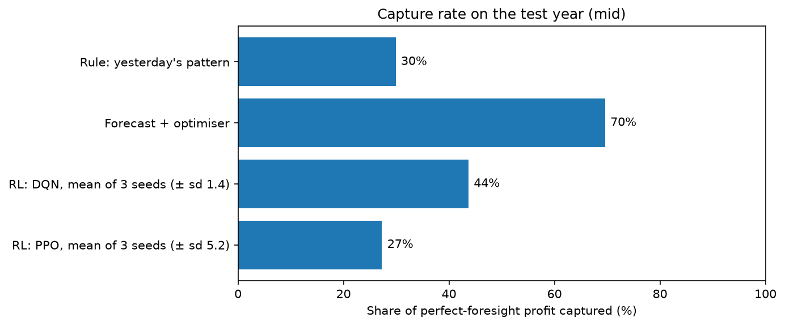
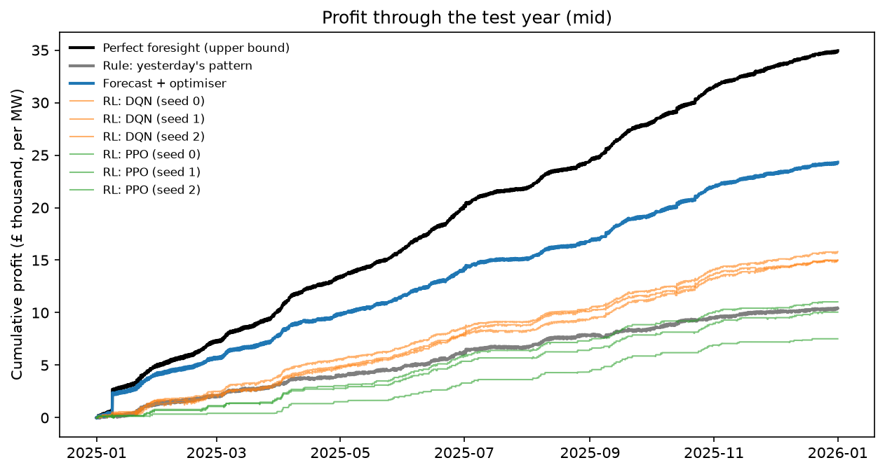
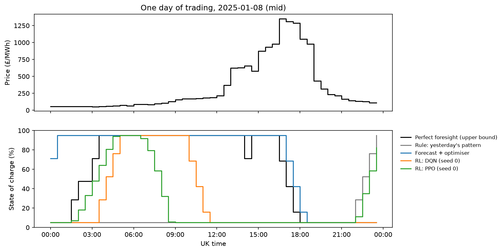
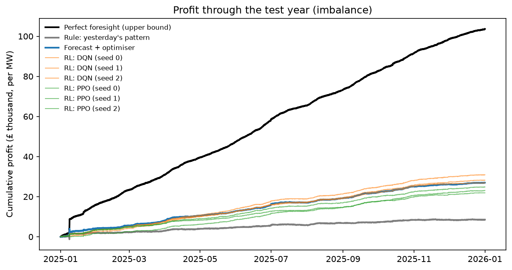

# GB Battery Trader

[](https://github.com/ConnorLava42/gb-battery-trader/actions/workflows/ci.yml)

A 1 MW / 2 MWh grid battery trading Great Britain's half-hourly power prices four ways: a
simple rule, a perfect-foresight optimiser, a price forecast + optimiser, and reinforcement
learning agents. All four are scored with the same simulator on 2025, a year none of them
saw while being built.



## Headline

On the 2025 wholesale (Market Index) price, **forecast + optimiser captured 69.6%** of the
perfect-foresight profit (£24,328 per MW per year), against 29.9% for a simple rule and
43.7% ± 1.4 for a DQN agent averaged over three seeds.

On the spikier imbalance price every method captures far less, and the order flips: **DQN
(27.7% ± 2.0) edges ahead of forecast + optimiser (26.1%)**. When prices are hard to
forecast, a policy learned from experience can match a planner that trusts its forecast.

## Results

Capture rate is the share of the perfect-foresight profit a method keeps. Profit is after
a £10/MWh wear cost. RL rows are the mean of three seeds (± standard deviation of the
capture rate); every seed is listed further down.

| Method | Wholesale (MID): capture | £ per MW per year | cycles per day | Imbalance: capture | £ per MW per year | cycles per day |
| --- | ---: | ---: | ---: | ---: | ---: | ---: |
| Perfect foresight (upper bound) | 100% | 34,947 | 1.51 | 100% | 103,630 | 3.39 |
| Rule: yesterday's pattern | 29.9% | 10,437 | 0.84 | 8.3% | 8,565 | 0.86 |
| **Forecast + optimiser** | **69.6%** | **24,328** | 1.34 | 26.1% | 27,012 | 1.51 |
| RL: DQN (3 seeds) | 43.7% ± 1.4 | 15,266 | 0.83 | **27.7% ± 2.0** | **28,708** | 1.34 |
| RL: PPO (3 seeds) | 27.3% ± 5.2 | 9,531 | 0.29 | 22.5% ± 1.4 | 23,286 | 1.35 |



### Calm days and volatile days

A day is volatile if its price range is in the top quarter of 2025. Capture rate on each:

| Method | MID calm | MID volatile | Imbalance calm | Imbalance volatile |
| --- | ---: | ---: | ---: | ---: |
| Rule: yesterday's pattern | 29.7% | 30.0% | 3.7% | 14.9% |
| Forecast + optimiser | 62.1% | 76.4% | 20.4% | 34.4% |
| RL: DQN (mean of 3 seeds) | 34.3% | 52.1% | 24.7% | 32.1% |
| RL: PPO (mean of 3 seeds) | 11.4% | 41.5% | 19.7% | 26.6% |

### How good is the price forecast?

LightGBM forecasts the next 24 hours every half-hour. Mean absolute error on 2025, in
£/MWh, against the naive "same time yesterday" forecast:

| Hours ahead | MID: model | MID: naive | Imbalance: model | Imbalance: naive |
| --- | ---: | ---: | ---: | ---: |
| 0–1 | 11.8 | 21.7 | 27.0 | 38.7 |
| 1–4 | 13.4 | 21.7 | 29.2 | 38.7 |
| 4–12 | 15.0 | 21.7 | 30.2 | 38.7 |
| 12–24 | 15.6 | 21.7 | 30.7 | 38.7 |

### The day that mattered most: 8 January 2025



The wholesale price climbed to £1,353/MWh at 16:30, and the imbalance price sat at
£2,900/MWh from 15:00 to 17:00. This one day held 6% of the year's perfect-foresight profit
on MID. Forecast + optimiser charged early, held the charge through the afternoon and sold
into the peak, earning £1,953 of the £2,075 available. The rule followed the day before's
pattern and lost £230. Leaving 8 January out entirely, forecast + optimiser still captures
68% of the rest of the year, so the headline doesn't rest on one lucky day.

<details>
<summary>Every seed, both markets</summary>

**Wholesale (MID), 2025**

| Method | capture rate (%) | £ per MW per year | cycles per day | calm (%) | volatile (%) |
| --- | ---: | ---: | ---: | ---: | ---: |
| Perfect foresight (upper bound) | 100.0 | 34,947 | 1.51 | 100.0 | 100.0 |
| Rule: yesterday's pattern | 29.9 | 10,437 | 0.84 | 29.7 | 30.0 |
| Forecast + optimiser | 69.6 | 24,328 | 1.34 | 62.1 | 76.4 |
| RL: DQN (seed 0) | 45.2 | 15,810 | 0.83 | 38.8 | 51.0 |
| RL: DQN (seed 1) | 43.0 | 15,026 | 0.72 | 28.1 | 56.4 |
| RL: DQN (seed 2) | 42.8 | 14,962 | 0.94 | 36.1 | 48.9 |
| RL: PPO (seed 0) | 31.6 | 11,032 | 0.40 | 16.1 | 45.4 |
| RL: PPO (seed 1) | 28.8 | 10,049 | 0.30 | 11.2 | 44.5 |
| RL: PPO (seed 2) | 21.5 | 7,513 | 0.18 | 6.9 | 34.6 |

**Imbalance, 2025**

| Method | capture rate (%) | £ per MW per year | cycles per day | calm (%) | volatile (%) |
| --- | ---: | ---: | ---: | ---: | ---: |
| Perfect foresight (upper bound) | 100.0 | 103,630 | 3.39 | 100.0 | 100.0 |
| Rule: yesterday's pattern | 8.3 | 8,565 | 0.86 | 3.7 | 14.9 |
| Forecast + optimiser | 26.1 | 27,012 | 1.51 | 20.4 | 34.4 |
| RL: DQN (seed 0) | 26.0 | 26,947 | 1.25 | 22.4 | 31.3 |
| RL: DQN (seed 1) | 29.8 | 30,933 | 1.50 | 27.0 | 34.0 |
| RL: DQN (seed 2) | 27.3 | 28,246 | 1.27 | 24.7 | 30.9 |
| RL: PPO (seed 0) | 24.0 | 24,835 | 1.55 | 20.5 | 29.1 |
| RL: PPO (seed 1) | 22.3 | 23,116 | 1.34 | 19.3 | 26.7 |
| RL: PPO (seed 2) | 21.1 | 21,905 | 1.17 | 19.3 | 23.9 |



</details>

## Which method suits which problem

| Situation | Best tool | Why |
| --- | --- | --- |
| Tomorrow's prices are known (Octopus Agile) | Linear programme | It finds the exact best plan, so RL has nothing to learn. A home battery (3 kW / 10 kWh, London region) planned at 4pm when prices are published captured 100% of the best saving, £504 in 2025, against 69.6% (£351) for the rule |
| Only past prices are known, and they are forecastable (wholesale) | Forecast + optimiser | A good forecast plus an exact optimiser beat the best RL agent by 26 points |
| Only past prices are known, and they are noisy (imbalance) | Forecast + optimiser and RL are level | The forecast error doubles, so the optimiser's plans are confidently wrong more often. RL is a real challenger here |

## How it works

1. **Data:** half-hourly Elexon Market Index and system prices, and archived Open-Meteo
   weather forecasts for wind farms and cities, 2021 to 2025.
2. **One simulator for everyone:** 90% round-trip efficiency, 5–95% state of charge,
   £10/MWh wear. Impossible actions are clipped, never penalised.
3. **Perfect foresight:** one linear programme over the whole year (HiGHS via SciPy). This
   is the impossible upper bound that every method is scored against.
4. **Forecast + optimiser:** LightGBM forecasts the next 24 hours of prices every
   half-hour. A linear programme is re-solved each time and only its first step is carried
   out.
5. **Reinforcement learning:** a Gymnasium environment that only shows the past. DQN and
   PPO from Stable-Baselines3, 300,000 steps and three seeds each, with the model chosen on
   2024.
6. **No leakage:** train 2021–2023, tune 2024, test 2025. Tests scramble future prices and
   check that no feature or observation changes.

## What I learned

- **Forecast quality decides everything for the optimiser.** On MID the forecast halves the
  error of "same time yesterday" an hour ahead, and the optimiser keeps 70% of the best
  profit. On imbalance the error is about twice as large, and the same code keeps 26%.
- **RL is competitive where forecasting is hard.** On imbalance, DQN matched or beat the
  optimiser on every seed but one, and its best seed lost money on 52 days against the
  optimiser's 84. The optimiser commits fully to whatever its forecast says; DQN learned
  a more cautious policy from experience.
- **PPO learned to sit still.** On MID it cycled only 0.18–0.40 times a day and captured
  7–16% on calm days, waiting for big spreads. It also varied most between seeds (± 5.2
  points), which is why every RL result here is reported over three seeds.
- **The imbalance ceiling is unreachable.** Perfect foresight cycles 3.4 times a day there,
  flipping on half-hour swings nobody could forecast. The low capture rates say as much
  about the ceiling as about the methods: in pounds, the best realistic imbalance result
  (£28,708) still beats the best wholesale one (£24,328).
- **A few days are worth a lot.** 8 January 2025 alone was 6–7% of the year's best
  possible profit in both markets. A strategy that misses days like that gives up more
  than one that is slightly worse every day.

## Reproduce it

```bash
git clone https://github.com/ConnorLava42/gb-battery-trader.git
cd gb-battery-trader
uv sync --extra rl
uv run batterytrader ingest          # 20-40 minutes
uv run batterytrader build
uv run batterytrader foresight --market mid
uv run batterytrader rule --market mid
uv run batterytrader forecast --market mid
uv run batterytrader mpc --market mid
uv run batterytrader rl-train --market mid --algo dqn --seed 0   # repeat for seeds 1-2 and --algo ppo
uv run batterytrader evaluate --market mid
uv run batterytrader agile           # optional: the Octopus Agile home battery
uv run pytest
```

Swap `--market mid` for `--market imbalance` to rerun everything on the imbalance price.

## Limitations

- Wholesale and imbalance arbitrage only: no ancillary services or Balancing Mechanism,
  which are a large share of real GB battery revenue.
- A price-taker: the battery's own trades never move the price.
- Weather inputs are archived forecasts that stitch recent model runs together, so they are
  slightly better than what was really available at decision time.
- Degradation is a flat cost per MWh; real cells age with depth of discharge and
  temperature.
- The 2022 gas crisis is in the training years. Training on 2023 onwards only would show
  whether that helps or hurts the 2025 results.

## Data and credits

Prices: Elexon BMRS (Insights Solution). Weather: [Open-Meteo.com](https://open-meteo.com/),
CC BY 4.0. Agile prices: Octopus Energy public API.
